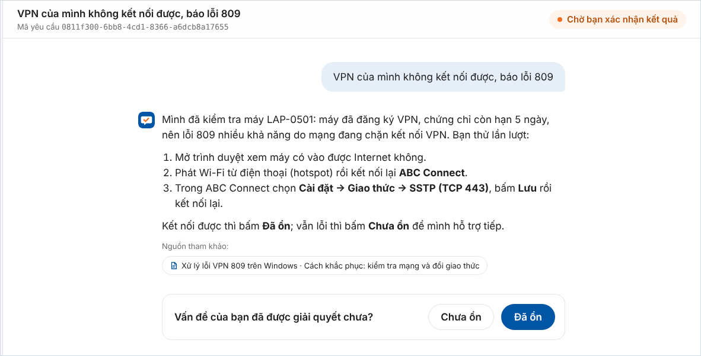
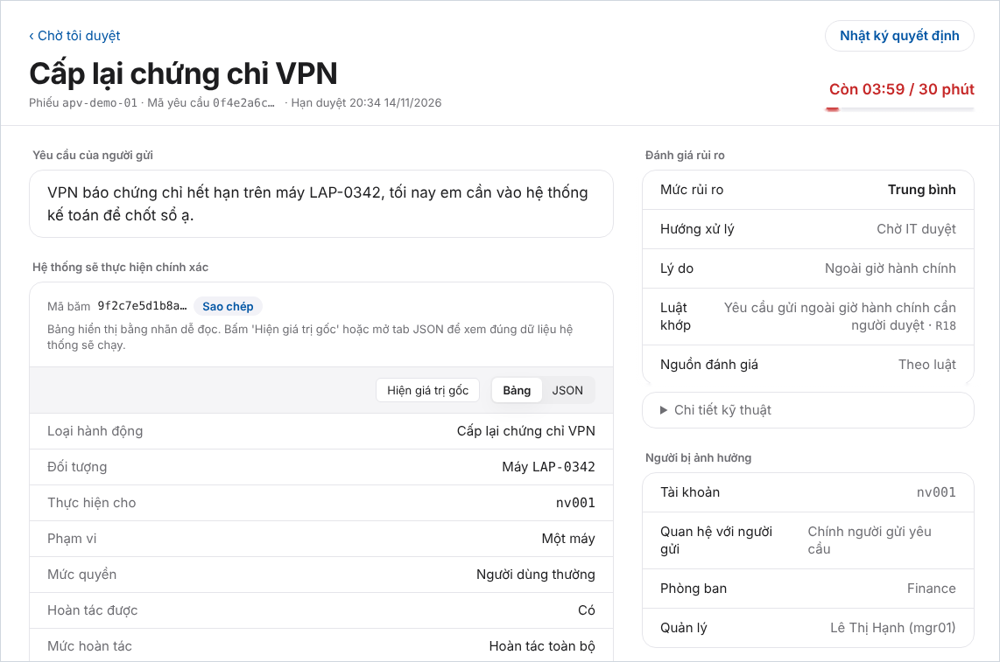

<p align="center">
  <picture>
    <source media="(prefers-color-scheme: dark)" srcset="docs/assets/logo-dark.svg">
    
  </picture>
</p>

<p align="center">
  An AI agent for Level-1 IT service desks that handles routine requests and escalates to a human when it should.
</p>

<p align="center">
  <a href="https://github.com/17tuanphamanh/AIP_FA26_G8/actions/workflows/ci.yml"></a>
  <a href="https://github.com/17tuanphamanh/AIP_FA26_G8/releases"></a>
  
  <a href="LICENSE"></a>
</p>

<p align="center">
  <a href="#quickstart">Quickstart</a> ·
  <a href="docs/HUONG-DAN-CHAY.md">Setup guide (Vietnamese)</a> ·
  <a href="docs/anh-demo/AITHA-anh-chup-demo-10-ca.pdf">10 demo cases (PDF)</a> ·
  <a href="README.md">Tiếng Việt</a>
</p>

<br>

<p align="center">
  
</p>

## Overview

AITHA takes IT requests written in Vietnamese, such as VPN problems, accounts, software installs and folder access. It
checks the requester's machine and the relevant systems. Then it either answers from internal documents with citations
or carries out the action. Sensitive actions always go through a policy layer and a human approver, and every decision
is logged.

AITHA is a graduation project in Artificial Intelligence at FPT University (Fall 2026). Its main contribution is the
mechanism that decides when a request must go to a human.

## Features

- **Vietnamese understanding**: splits multi-part requests, asks follow-up questions when details are missing, and checks
  system state before it answers.
- **Grounded answers**: hybrid RAG combines bge-m3 with BM25, reranked by bge-reranker-v2-m3. When the evidence is too
  weak, it hands off to a person instead of guessing.
- **Policy first**: 23 deterministic rules, and the strictest matching rule wins. The LLM cannot override a rule.
- **Safe approval and execution**:
  - each approval is bound to a hash of one exact action;
  - the department head confirms with an OTP;
  - the rules are re-checked right before execution;
  - every action can be rolled back.
- **Prompt-injection defense**: combines hard patterns, a classifier the team fine-tuned and an LLM judge. Passwords, keys
  and personal data are masked before anything reaches the LLM.
- **Administration**: the IT department head chooses how the system makes decisions. Each change is recorded, and
  monitoring dashboards are available.

## How it works

<picture>
  <source media="(prefers-color-scheme: dark)" srcset="docs/assets/luong-quyet-dinh-dark.svg">
  
</picture>

Each request runs through a 20-step LangGraph workflow, and the policy always runs first. Only requests that no rule
covers go to the LLM risk estimate. Until a reliable calibration set exists, that layer can only escalate to a human; it
never acts on its own. A failure at any step also escalates, so no request is left hanging.

The approver sees the exact action that will run, its hash, the risk level and the rule that matched (the screen is in
Vietnamese):

<p align="center">
  
</p>

## Results

These figures come from the frozen build `v1.0-freeze`, run with a real LLM. The retrieval figure is the exception: it
was measured on the submitted build. The thesis describes the methods and the limitations.

| Measure | Result |
| --- | --- |
| LLM-layer safety, 100 labelled scenarios | Missed 0 of 24 cases that needed a human; 95% upper bound 11.7% |
| Prompt-injection screening, 95 hand-written sentences labelled blind | The full pipeline caught 82%, the team's classifier alone 62%, Prompt Guard 2 20%; 1 of 45 benign sentences flagged |
| Retrieval, 34 articles (submitted build) | Recall@5 = 1.000; MRR = 0.845 |
| Independent rerun | Decisions matched in 90 of 90 cases |

**Limitations**:

- The current evaluation set does not yet show a cost benefit from combining rules with an LLM over using rules alone.
- The system has run only against simulated IT systems.

## Quickstart

**Requirements:**

- Software: Docker Desktop, git, make, Python 3, [uv](https://docs.astral.sh/uv/) and Node.js 24. On Windows, run it
  inside WSL2.
- Hardware: 16 GB of RAM and 25 GB of free disk space.

The first run takes about 45–60 minutes, mostly to download the models.

```bash
git clone https://github.com/17tuanphamanh/aip_fa26_g8 && cd aip_fa26_g8
# Put the .env file shared privately by the team in this folder
make models                    # downloads bge-m3 and bge-reranker-v2-m3 (about 4.5 GB)
# Unzip aitha-model-freeze.zip into ml_models/
chmod -R a+rX ml_models models
make up && make ingest         # starts the stack and loads the knowledge base
cd frontend && npm ci && npm run dev
```

Then open http://localhost:5173. All demo accounts use the password `Demo@2026!`:

| Account | Role |
| --- | --- |
| `an.nv` | Employee |
| `ha.lt` | IT L1, approves requests |
| `long.nh` | L2 technician |
| `quan.tm` | IT department head; set up the OTP once (setup guide, section 8) |

The full [setup guide](docs/HUONG-DAN-CHAY.md) (in Vietnamese) covers:

- running without `.env` (the stack then uses a scripted LLM);
- running on 8 GB machines;
- troubleshooting.

## Versions

| Version | Used for |
| --- | --- |
| [`v1.1-nop-1411`](https://github.com/17tuanphamanh/AIP_FA26_G8/releases/tag/v1.1-nop-1411), branch `main` | Submitted source code and demo video |
| [`v1.0-freeze`](https://github.com/17tuanphamanh/AIP_FA26_G8/releases/tag/v1.0-freeze) (`bf94df2`) | Measured build: every figure in the thesis comes from this build |

## Team

The team is Phạm Tuấn Anh (lead), Phạm Lưu Dương, Tạ Duy Anh and Dương Anh Quân. The project was supervised by Dr. Lê Đình
Huynh at FPT University.

## License

[MIT](LICENSE)
