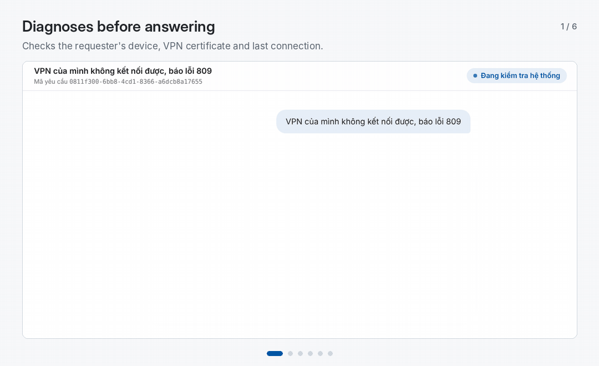
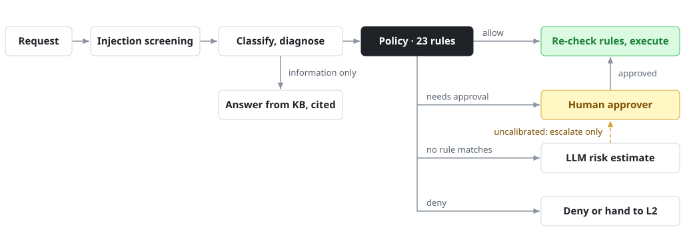

<p align="center">
  <picture>
    <source media="(prefers-color-scheme: dark)" srcset="docs/assets/logo-dark.svg">
    
  </picture>
</p>

<h3 align="center">An AI agent for Level-1 IT service desks</h3>

<p align="center">
  It handles routine IT requests on its own. A person approves anything risky.
</p>

<p align="center">
  <a href="https://github.com/17tuanphamanh/AIP_FA26_G8/actions/workflows/ci.yml"></a>
  <a href="https://github.com/17tuanphamanh/AIP_FA26_G8/releases"></a>
  
  <a href="LICENSE"></a>
</p>

<p align="center">
  <a href="#quickstart"><b>Quickstart</b></a> &nbsp;·&nbsp;
  <a href="docs/HUONG-DAN-CHAY.md"><b>Setup guide</b></a> &nbsp;·&nbsp;
  <a href="docs/anh-demo/AITHA-anh-chup-demo-10-ca.pdf"><b>10 demo cases</b></a> &nbsp;·&nbsp;
  <a href="README.md"><b>Tiếng Việt</b></a>
</p>

<p align="center">
  
  <br>
  <sub>Assembled from screenshots of the submitted build (interface in Vietnamese). All 10 demo cases are in the <a href="docs/anh-demo/AITHA-anh-chup-demo-10-ca.pdf">demo PDF</a>.</sub>
</p>

AITHA takes IT requests written in Vietnamese, such as VPN errors, forgotten passwords, software installs or folder
access. It checks the requester's machine and the relevant systems. Then it either answers from internal documents or
carries out the action. AITHA is a graduation project in Artificial Intelligence at FPT University (Fall 2026). Its main
contribution is the mechanism that decides when a request must go to a human.

## Features

<table>
  <tr>
    <td width="33%" valign="top"><b>Understands and diagnoses</b><br>Splits multi-part requests, asks follow-ups and checks the machine before it answers.</td>
    <td width="33%" valign="top"><b>Grounded answers</b><br>Hybrid RAG with bge-m3 and BM25. With weak evidence, it hands off to a person.</td>
    <td width="33%" valign="top"><b>Policy first</b><br>23 rules, and the strictest match wins. The LLM cannot override a rule.</td>
  </tr>
  <tr>
    <td valign="top"><b>Safe approvals</b><br>Each approval is bound to one exact action and confirmed with an OTP. Every action can be rolled back.</td>
    <td valign="top"><b>Injection defense</b><br>Hard patterns, a fine-tuned classifier and an LLM judge. Secrets are masked first.</td>
    <td valign="top"><b>Administration</b><br>Versioned policy changes and monitoring dashboards for the IT department head.</td>
  </tr>
</table>

## How it works

<picture>
  <source media="(prefers-color-scheme: dark)" srcset="docs/assets/luong-quyet-dinh-en-dark.svg">
  
</picture>

Each request runs through a 20-step LangGraph workflow, and the policy is
always checked first. Only requests that no rule covers go to the LLM risk estimate. Until it is calibrated, that layer can
only escalate to a person. A failure at any step also escalates.

**Stack:** Python 3.12, FastAPI, LangGraph, PostgreSQL, Qdrant, bge-m3, XLM-RoBERTa, React 19, Docker Compose.

## Results

<table>
  <tr>
    <td align="center" valign="top" width="25%"><h3>0/24</h3>cases needing a human that the LLM layer missed</td>
    <td align="center" valign="top" width="25%"><h3>82%</h3>attack sentences caught (Prompt Guard 2: 20%)</td>
    <td align="center" valign="top" width="25%"><h3>1.000</h3>retrieval Recall@5</td>
    <td align="center" valign="top" width="25%"><h3>90/90</h3>decisions matched on an independent rerun</td>
  </tr>
</table>

<details>
<summary>Measurement details and limitations</summary>
<br>

All figures except retrieval come from the frozen build `v1.0-freeze`, run with a real LLM. Retrieval was measured on the
submitted build.

| Measure | Data | Result |
| --- | --- | --- |
| LLM-layer safety | 100 labelled scenarios | Missed 0 of 24; 95% upper bound 11.7% |
| Prompt-injection screening | 95 hand-written sentences, labelled blind | Full pipeline 82%, team classifier 62%, Prompt Guard 2 20%; 1 of 45 benign flagged |
| Retrieval | 34 articles, submitted build | Recall@5 1.000; MRR 0.845 |
| Reproducibility | Second person reran it | 90 of 90 decisions matched |

**Limitations:**

- The current evaluation set does not yet show that combining rules with an LLM costs less than using rules alone.
- The system has only run against simulated IT systems.

The thesis describes the full methodology.

</details>

## Quickstart

**Requirements:**

- Docker Desktop, git, make, Python 3, [uv](https://docs.astral.sh/uv/) and Node.js 24.
- A machine with 16 GB of RAM. On Windows, use WSL2.

The first run takes about 45–60 minutes, mostly to download the models.

```bash
git clone https://github.com/17tuanphamanh/aip_fa26_g8 && cd aip_fa26_g8
# Put the .env file shared privately by the team in this folder
make models                    # bge-m3 and bge-reranker-v2-m3, about 4.5 GB
# Unzip aitha-model-freeze.zip into ml_models/
chmod -R a+rX ml_models models
make up && make ingest
cd frontend && npm ci && npm run dev
```

Open http://localhost:5173 and sign in with the shared password `Demo@2026!`:

| Account | Role |
| --- | --- |
| `an.nv` | Employee |
| `ha.lt` | IT L1, approves requests |
| `long.nh` | L2 technician |
| `quan.tm` | IT department head; set up the OTP once (setup guide, section 8) |

The [setup guide](docs/HUONG-DAN-CHAY.md) is in Vietnamese. It covers:

- running without `.env`;
- running on 8 GB machines;
- troubleshooting.

## Versions

| Version | Contents |
| --- | --- |
| [`v1.2-nop-1511`](https://github.com/17tuanphamanh/AIP_FA26_G8/releases/tag/v1.2-nop-1511) (`a2f4ad1`) | Submitted build: the exact source sent to the supervisor on 15 Nov 2026 |
| Branch `main` | Submitted build plus documentation and the RQ4 evaluation script added afterwards; runtime code is unchanged |
| [`v1.0-freeze`](https://github.com/17tuanphamanh/AIP_FA26_G8/releases/tag/v1.0-freeze) | Measured build used for the thesis research questions |

## Team

The team is Phạm Tuấn Anh (lead), Phạm Lưu Dương, Tạ Duy Anh and Dương Anh Quân. The project was supervised by Dr. Lê Đình
Huynh at FPT University.

## License

[MIT](LICENSE)
