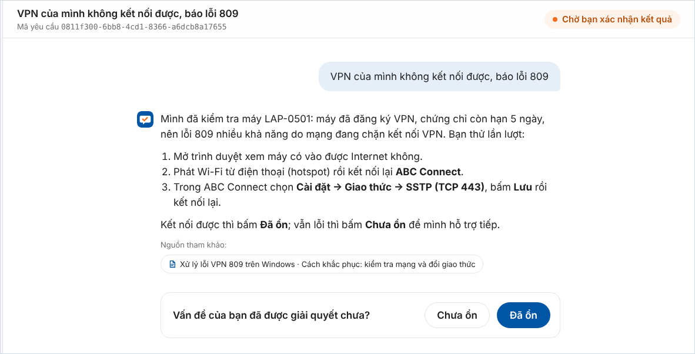

<p align="center">
  <picture>
    <source media="(prefers-color-scheme: dark)" srcset="docs/assets/logo-dark.svg">
    
  </picture>
</p>

<p align="center">
  Trợ lý AI cho IT Service Desk cấp 1: tự xử lý yêu cầu thường ngày, chuyển cho con người khi cần.
</p>

<p align="center">
  <a href="https://github.com/17tuanphamanh/AIP_FA26_G8/actions/workflows/ci.yml"></a>
  <a href="https://github.com/17tuanphamanh/AIP_FA26_G8/releases"></a>
  
  <a href="LICENSE"></a>
</p>

<p align="center">
  <a href="#bắt-đầu-nhanh">Bắt đầu nhanh</a> ·
  <a href="docs/HUONG-DAN-CHAY.md">Hướng dẫn chạy</a> ·
  <a href="docs/anh-demo/AITHA-anh-chup-demo-10-ca.pdf">Demo 10 ca (PDF)</a> ·
  <a href="README.en.md">English</a>
</p>

<br>

<p align="center">
  
</p>

## Giới thiệu

AITHA nhận yêu cầu IT bằng tiếng Việt: VPN, tài khoản, cài phần mềm, quyền thư mục. Trợ lý tự kiểm tra máy và hệ thống
của người gửi, rồi trả lời từ tài liệu nội bộ kèm nguồn hoặc thực hiện thao tác. Thao tác nhạy cảm luôn đi qua chính sách
và người duyệt, mọi quyết định đều có nhật ký.

Đây là đồ án tốt nghiệp ngành Trí tuệ nhân tạo, Đại học FPT, kỳ Fall 2026. Đóng góp chính của đồ án là cơ chế quyết định
khi nào phải chuyển cho con người.

## Tính năng

- **Hiểu yêu cầu tiếng Việt**: tách yêu cầu nhiều ý, hỏi lại khi thiếu thông tin và kiểm tra trạng thái hệ thống trước
  khi trả lời.
- **Trả lời có nguồn**: RAG lai gồm bge-m3 và BM25, rerank bằng bge-reranker-v2-m3. Khi không đủ căn cứ, trợ lý chuyển
  cho người thay vì đoán.
- **Chính sách quyết định trước**: 23 luật, khi nhiều luật cùng khớp thì luật chặt nhất được áp dụng. LLM không ghi đè
  được luật.
- **Duyệt và thực thi an toàn**:
  - phiếu duyệt gắn mã băm của đúng một hành động;
  - trưởng bộ phận xác nhận bằng OTP;
  - luật được kiểm lại ngay trước khi chạy;
  - thao tác hoàn tác được.
- **Chống prompt injection**: kết hợp mẫu cứng, model phân loại nhóm tự fine-tune và LLM chấm. Mật khẩu, khoá và dữ liệu
  cá nhân được che trước khi gửi cho LLM.
- **Quản trị**: trưởng bộ phận IT chọn cách hệ thống ra quyết định, có lịch sử thay đổi và bảng giám sát.

## Cách hoạt động

<picture>
  <source media="(prefers-color-scheme: dark)" srcset="docs/assets/luong-quyet-dinh-dark.svg">
  
</picture>

Mỗi yêu cầu đi qua luồng 20 bước dựng trên LangGraph. Chính sách luôn chạy trước. Việc không luật nào phủ mới chuyển sang
LLM đánh giá rủi ro. Khi chưa có bộ hiệu chỉnh đủ tin cậy, lớp LLM chỉ được chuyển việc lên người, không bao giờ tự thực
hiện. Lỗi ở bất kỳ bước nào cũng dẫn tới chuyển người, nên yêu cầu không bị treo.

Người duyệt thấy đúng hành động sẽ chạy, mã băm, mức rủi ro và luật đã khớp:

<p align="center">
  
</p>

## Kết quả

Các số dưới đây đo với LLM thật trên bản đóng băng `v1.0-freeze`; riêng phép đo truy hồi làm trên bản nộp. Phương pháp và
giới hạn được trình bày trong báo cáo đồ án.

| Phép đo | Kết quả |
| --- | --- |
| An toàn của lớp LLM, 100 kịch bản có nhãn | Bỏ sót 0/24 tình huống cần người; cận trên 95% là 11,7% |
| Chặn prompt injection, 95 câu viết tay gán nhãn mù | Kết hợp nhiều lớp bắt 82%, riêng model nhóm 62%, Prompt Guard 2 20%; chặn nhầm 1/45 câu thường |
| Truy hồi tài liệu, 34 bài (bản nộp) | Recall@5 = 1,000; MRR = 0,845 |
| Tái lập độc lập | Khớp quyết định 90/90 ca |

**Giới hạn**:

- Lợi ích về chi phí khi kết hợp luật với LLM, so với chỉ dùng luật, chưa được chứng minh trên bộ đánh giá hiện tại.
- Hệ thống mới chạy trên môi trường giả lập.

## Bắt đầu nhanh

**Cần có:**

- Phần mềm: Docker Desktop, git, make, Python 3, [uv](https://docs.astral.sh/uv/), Node.js 24. Trên Windows thì chạy
  trong WSL2.
- Máy: RAM 16 GB và ổ trống từ 25 GB.

Lần chạy đầu mất khoảng 45–60 phút, chủ yếu để tải model.

```bash
git clone https://github.com/17tuanphamanh/aip_fa26_g8 && cd aip_fa26_g8
# Đặt file .env nhóm gửi riêng vào thư mục này
make models                    # tải bge-m3 và bge-reranker-v2-m3 (khoảng 4,5 GB)
# Giải nén aitha-model-freeze.zip vào ml_models/
chmod -R a+rX ml_models models
make up && make ingest         # dựng hệ thống và nạp kho tài liệu
cd frontend && npm ci && npm run dev
```

Mở http://localhost:5173. Các tài khoản demo dùng chung mật khẩu `Demo@2026!`:

| Tài khoản | Vai trò |
| --- | --- |
| `an.nv` | Nhân viên |
| `ha.lt` | IT L1, duyệt phiếu |
| `long.nh` | Kỹ thuật viên L2 |
| `quan.tm` | Trưởng bộ phận IT; đặt OTP một lần theo hướng dẫn mục 8 |

Hướng dẫn đầy đủ nằm ở [docs/HUONG-DAN-CHAY.md](docs/HUONG-DAN-CHAY.md), gồm:

- cách chạy khi không có `.env` (khi đó hệ thống dùng LLM giả);
- cách chạy trên máy 8 GB RAM;
- các lỗi hay gặp.

## Bản nộp và bản đo

| Phiên bản | Dùng cho |
| --- | --- |
| [`v1.1-nop-1411`](https://github.com/17tuanphamanh/AIP_FA26_G8/releases/tag/v1.1-nop-1411), nhánh `main` | Mã nguồn nộp và video demo |
| [`v1.0-freeze`](https://github.com/17tuanphamanh/AIP_FA26_G8/releases/tag/v1.0-freeze) (`bf94df2`) | Bản đo: mọi số liệu trong báo cáo đều đo trên bản này |

[docs/PHAT-TRIEN.md](docs/PHAT-TRIEN.md#bản-nộp-và-bản-đo) trình bày những điểm bản nộp khác bản đo, các cờ tính năng và
cách tái lập số liệu.

## Tài liệu

- [Hướng dẫn chạy](docs/HUONG-DAN-CHAY.md)
- [Hướng dẫn phát triển](docs/PHAT-TRIEN.md): dựng môi trường, test, cấu trúc thư mục, quy ước commit
- [Đặc tả và quyết định thiết kế](docs/spec/)
- [Kiến trúc](docs/kien-truc/)
- [Model của nhóm](ml_models/MODELS.md)

## Nhóm thực hiện

| Thành viên | Phụ trách |
| --- | --- |
| Phạm Tuấn Anh (nhóm trưởng) | Kiến trúc, đặc tả, luồng agent, cơ chế chuyển người, duyệt và thực thi, giao diện |
| Phạm Lưu Dương | Tầng giám sát, model chặn tấn công, thực nghiệm RQ1, dữ liệu RQ4 |
| Tạ Duy Anh | Tầng giám sát, model phân loại yêu cầu, thực nghiệm RQ3 và RQ4 |
| Dương Anh Quân | Tổng quan tài liệu, thực nghiệm RQ2, kiểm thử và chất lượng, dữ liệu RQ4 |

Giảng viên hướng dẫn: TS. Lê Đình Huynh, Trường Đại học FPT.

Nhóm dùng Claude Code để hỗ trợ viết mã (cấu hình ở `CLAUDE.md` và `.claude/`); mức độ dùng AI được khai báo trong báo
cáo.

## Giấy phép

[MIT](LICENSE)
