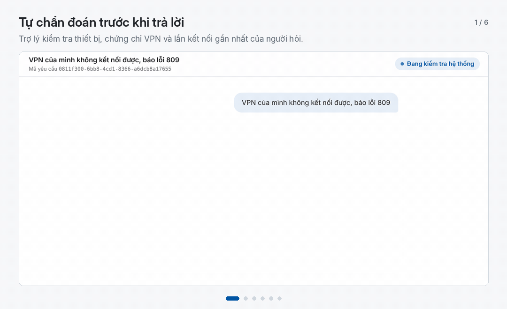

<p align="center">
  <picture>
    <source media="(prefers-color-scheme: dark)" srcset="docs/assets/logo-dark.svg">
    
  </picture>
</p>

<h3 align="center">Trợ lý AI cho IT Service Desk cấp 1</h3>

<p align="center">
  Tự xử lý yêu cầu IT thường ngày. Việc có rủi ro luôn có người duyệt.
</p>

<p align="center">
  <a href="https://github.com/17tuanphamanh/AIP_FA26_G8/actions/workflows/ci.yml"></a>
  <a href="https://github.com/17tuanphamanh/AIP_FA26_G8/releases"></a>
  
  <a href="LICENSE"></a>
</p>

<p align="center">
  <a href="#bắt-đầu-nhanh"><b>Bắt đầu nhanh</b></a> &nbsp;·&nbsp;
  <a href="docs/HUONG-DAN-CHAY.md"><b>Hướng dẫn chạy</b></a> &nbsp;·&nbsp;
  <a href="docs/anh-demo/AITHA-anh-chup-demo-10-ca.pdf"><b>Demo 10 ca</b></a> &nbsp;·&nbsp;
  <a href="README.en.md"><b>English</b></a>
</p>

<p align="center">
  
  <br>
  <sub>Dựng từ ảnh chụp giao diện bản nộp. Xem đủ 10 ca trong <a href="docs/anh-demo/AITHA-anh-chup-demo-10-ca.pdf">bản PDF demo</a>.</sub>
</p>

AITHA nhận yêu cầu IT bằng tiếng Việt, ví dụ lỗi VPN, quên mật khẩu, cài phần mềm hoặc xin quyền thư mục. Trợ lý tự kiểm
tra máy và hệ thống của người gửi, rồi trả lời từ tài liệu nội bộ hoặc thực hiện thao tác. Đây là đồ án tốt nghiệp ngành
Trí tuệ nhân tạo, Đại học FPT (Fall 2026). Đóng góp chính của đồ án là cơ chế quyết định khi nào phải chuyển việc cho
con người.

## Tính năng

<table>
  <tr>
    <td width="33%" valign="top"><b>Hiểu và tự chẩn đoán</b><br>Tách yêu cầu nhiều ý, hỏi lại khi thiếu, kiểm tra máy trước khi trả lời.</td>
    <td width="33%" valign="top"><b>Trả lời có nguồn</b><br>RAG lai bge-m3 + BM25. Thiếu căn cứ thì chuyển người.</td>
    <td width="33%" valign="top"><b>Chính sách đi trước</b><br>23 luật, luật chặt nhất thắng. LLM không ghi đè được.</td>
  </tr>
  <tr>
    <td valign="top"><b>Duyệt an toàn</b><br>Phiếu gắn mã băm của đúng một hành động, OTP, hoàn tác được.</td>
    <td valign="top"><b>Chống prompt injection</b><br>Mẫu cứng, model tự fine-tune, LLM chấm; che dữ liệu nhạy cảm.</td>
    <td valign="top"><b>Quản trị</b><br>Đổi chính sách có lịch sử, bảng giám sát cho trưởng bộ phận IT.</td>
  </tr>
</table>

## Cách hoạt động

<picture>
  <source media="(prefers-color-scheme: dark)" srcset="docs/assets/luong-quyet-dinh-dark.svg">
  
</picture>

Mỗi yêu cầu đi qua luồng 20 bước trên LangGraph, và chính sách luôn được xét trước. Chỉ những việc không luật nào phủ
mới chuyển sang LLM đánh giá rủi ro. Khi chưa được hiệu chỉnh, lớp LLM chỉ có quyền chuyển việc lên người. Lỗi ở bất kỳ
bước nào cũng dẫn tới chuyển người.

**Công nghệ:** Python 3.12, FastAPI, LangGraph, PostgreSQL, Qdrant, bge-m3, XLM-RoBERTa, React 19, Docker Compose.

## Kết quả

<table>
  <tr>
    <td align="center" valign="top" width="25%"><h3>0/24</h3>ca cần người bị LLM bỏ sót</td>
    <td align="center" valign="top" width="25%"><h3>82%</h3>câu tấn công bị chặn (Prompt Guard 2: 20%)</td>
    <td align="center" valign="top" width="25%"><h3>1,000</h3>Recall@5 khi truy hồi tài liệu</td>
    <td align="center" valign="top" width="25%"><h3>90/90</h3>quyết định khớp khi chạy lại</td>
  </tr>
</table>

<details>
<summary>Chi tiết phép đo và giới hạn</summary>
<br>

Các số trên đo với LLM thật trên bản đóng băng `v1.0-freeze`; riêng truy hồi đo trên bản nộp.

| Phép đo | Bộ dữ liệu | Kết quả |
| --- | --- | --- |
| An toàn lớp LLM | 100 kịch bản có nhãn | Bỏ sót 0/24; cận trên 95% là 11,7% |
| Chặn prompt injection | 95 câu viết tay, gán nhãn mù | Nhiều lớp 82%, model nhóm 62%, Prompt Guard 2 20%; chặn nhầm 1/45 |
| Truy hồi tài liệu | 34 bài, bản nộp | Recall@5 1,000; MRR 0,845 |
| Tái lập | Người thứ hai chạy lại | Khớp 90/90 quyết định |

Giới hạn:

- Lợi ích chi phí của việc kết hợp luật với LLM chưa được chứng minh trên bộ đánh giá hiện tại.
- Hệ thống mới chạy trên môi trường giả lập.

Phương pháp đầy đủ có trong báo cáo đồ án.

</details>

## Bắt đầu nhanh

Cần Docker Desktop, git, make, Python 3, [uv](https://docs.astral.sh/uv/), Node.js 24 và máy RAM 16 GB. Trên Windows,
chạy trong WSL2. Lần đầu mất khoảng 45–60 phút để tải model.

```bash
git clone https://github.com/17tuanphamanh/aip_fa26_g8 && cd aip_fa26_g8
# Đặt file .env nhóm gửi riêng vào thư mục này
make models                    # bge-m3 và bge-reranker-v2-m3, khoảng 4,5 GB
# Giải nén aitha-model-freeze.zip vào ml_models/
chmod -R a+rX ml_models models
make up && make ingest
cd frontend && npm ci && npm run dev
```

Mở http://localhost:5173 và đăng nhập bằng mật khẩu chung `Demo@2026!`:

| Tài khoản | Vai trò |
| --- | --- |
| `an.nv` | Nhân viên |
| `ha.lt` | IT L1, duyệt phiếu |
| `long.nh` | Kỹ thuật viên L2 |
| `quan.tm` | Trưởng bộ phận IT, đặt OTP một lần theo mục 8 của hướng dẫn |

Muốn chạy không có `.env`, chạy trên máy 8 GB hoặc gặp lỗi, xem [hướng dẫn chạy](docs/HUONG-DAN-CHAY.md).

## Tài liệu

- [Hướng dẫn chạy](docs/HUONG-DAN-CHAY.md)
- [Hướng dẫn phát triển](docs/PHAT-TRIEN.md): môi trường dev, test, cấu trúc thư mục, quy ước commit
- [Đặc tả và quyết định thiết kế](docs/spec/)
- [Sơ đồ kiến trúc](docs/kien-truc/)
- [Model của nhóm](ml_models/MODELS.md)

| Phiên bản | Nội dung |
| --- | --- |
| [`v1.2-nop-1511`](https://github.com/17tuanphamanh/AIP_FA26_G8/releases/tag/v1.2-nop-1511) (`a2f4ad1`) | Bản nộp: đúng mã nguồn gửi thầy ngày 15/11/2026 |
| Nhánh `main` | Bản nộp cộng tài liệu và script đánh giá RQ4 thêm sau hạn; code chạy hệ thống không đổi |
| [`v1.0-freeze`](https://github.com/17tuanphamanh/AIP_FA26_G8/releases/tag/v1.0-freeze) | Bản đo, dùng cho các số liệu RQ trong báo cáo |

Hai bản khác nhau ở đâu: xem [docs/PHAT-TRIEN.md](docs/PHAT-TRIEN.md#bản-nộp-và-bản-đo).

## Nhóm thực hiện

| Thành viên | Phụ trách |
| --- | --- |
| **Phạm Tuấn Anh** (nhóm trưởng) | Kiến trúc, luồng agent, cơ chế chuyển người, duyệt và thực thi, giao diện |
| **Phạm Lưu Dương** | Tầng giám sát, model chặn tấn công, RQ1, dữ liệu RQ4 |
| **Tạ Duy Anh** | Tầng giám sát, model phân loại yêu cầu, RQ3, RQ4 |
| **Dương Anh Quân** | Tổng quan tài liệu, RQ2, kiểm thử, dữ liệu RQ4 |

Giảng viên hướng dẫn: TS. Lê Đình Huynh, Trường Đại học FPT.


## Giấy phép

[MIT](LICENSE)
